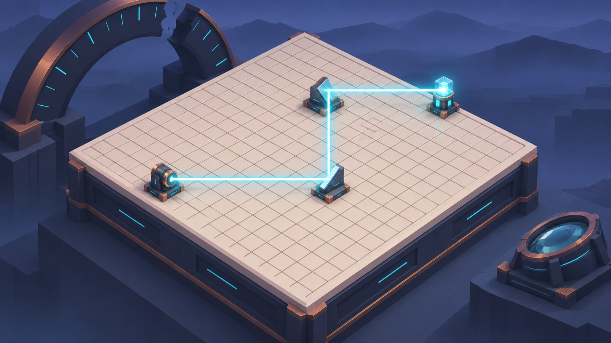
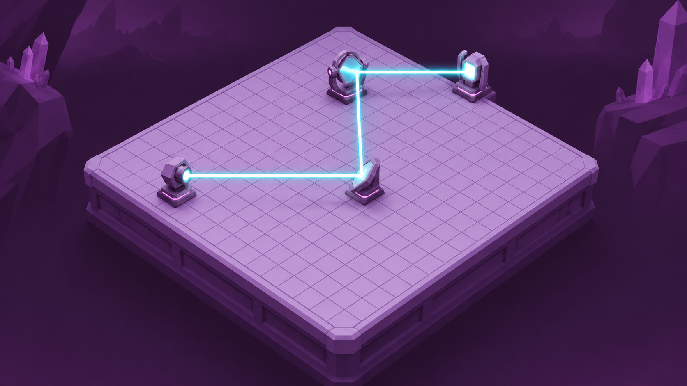
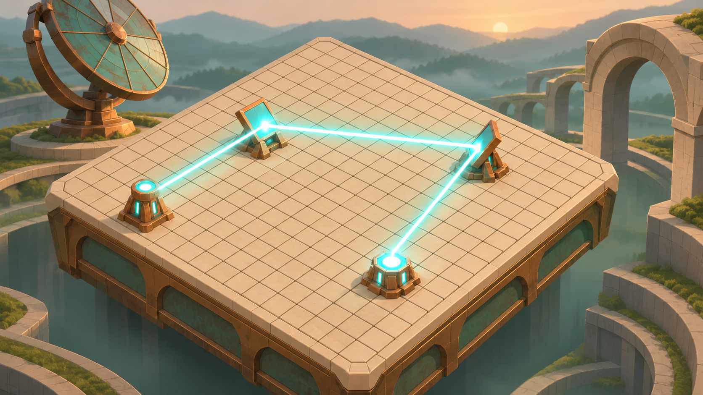
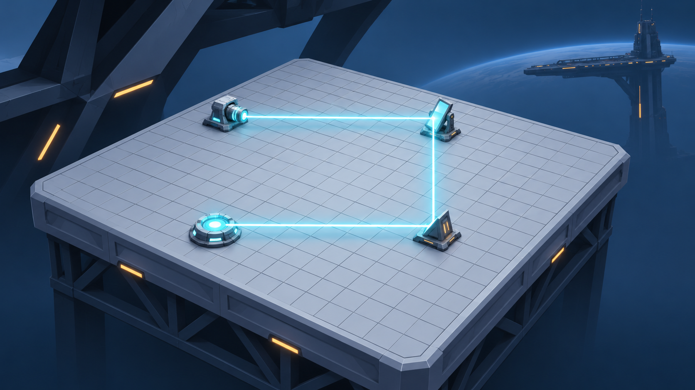

# Kierunki artystyczne

## Obserwatorium pryzmatyczne

Jasna ceramika na stalowym cokole, miedziane fazy i dwie duże formy optyczne.

## Kryształowa grota

Matowa liliowa platforma nad ciemną mgłą, pomiędzy dwiema grupami ametystów.

## Ogród heliostatów

Wapień, spatynowana miedź i tarasowy krajobraz z heliostatem i kamiennym łukiem.

## Stocznia orbitalna

Tytanowy pokład, stalowa kratownica i daleki horyzont planety.

[Prompty ImageGen](PROMPTS.md) · [Ocena koncepcji](../QA_LOG.md#18-listopada-2026--faza-1)
